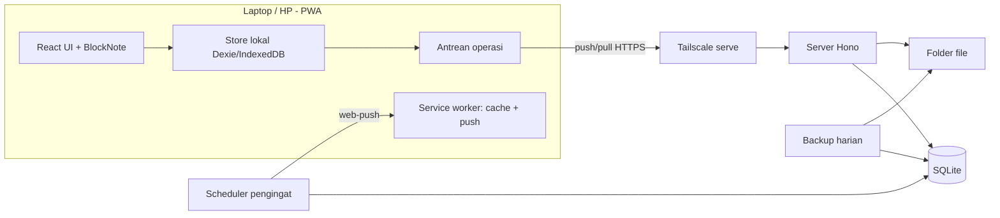
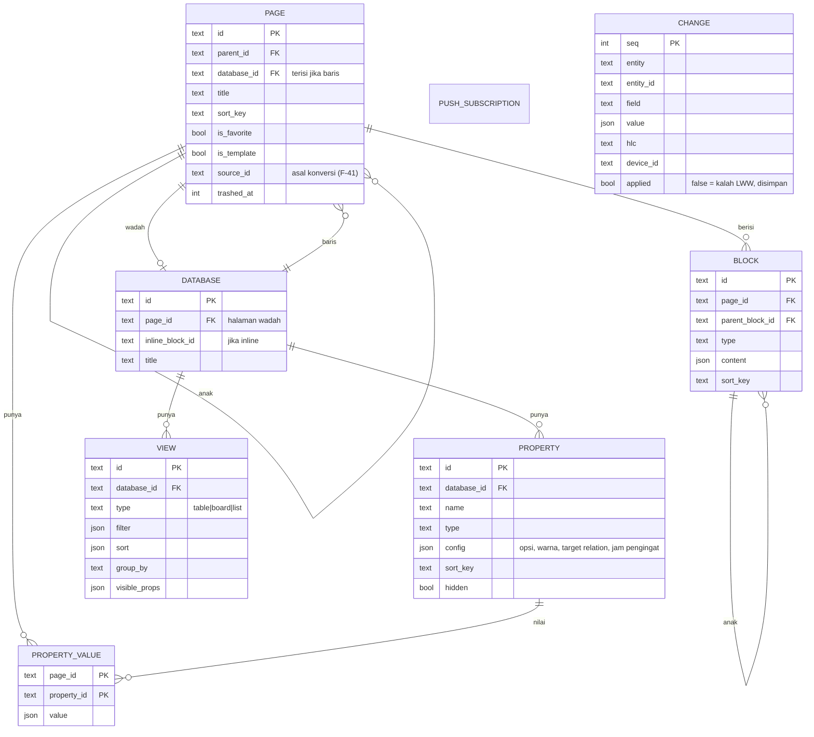
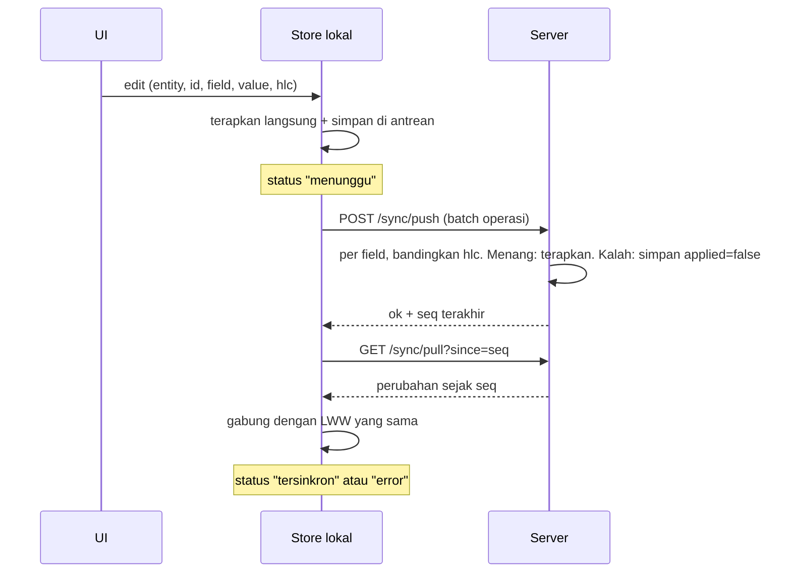

# NonsTop MVP 1

## Goal
Membangun semua fungsi berprioritas M di `docs/requirements.md` v0.2, sampai NonsTop bisa dipakai harian di laptop dan HP Android, termasuk saat offline.

## Requirements
Sumber: `docs/requirements.md` v0.2 (`approved`, 2026-11-04). Plan ini hanya mencakup fungsi M:

- Halaman: F-01, F-02, F-03, F-04, F-08, F-09
- Database: F-10, F-11, F-13, F-14, F-15
- View: F-20, F-21, F-22, F-23
- Template: F-30, F-31, F-32
- Scrum: F-40, F-41
- Tangkap dan cari: F-50, F-51, F-52
- Offline: F-60, F-61, F-62, F-63
- Akun dan data: F-70, F-71
- Non-fungsional: N-01 sampai N-06

## Design

### Keputusan stack
| Bagian | Pilihan | Alasan |
|---|---|---|
| Frontend | React + Vite + TypeScript, SPA | App offline-first merender semuanya dari data lokal. SSR Next.js tidak memberi manfaat dan menambah beban, salah satu sumber kerumitan `self-note`. |
| PWA | `vite-plugin-pwa` (Workbox) | Install di Android dan desktop, cache app shell, service worker untuk push. |
| Penyimpanan lokal | IndexedDB lewat Dexie | Data lengkap ada di perangkat. Halaman terbuka dari cache lokal (N-01). |
| Editor blok | BlockNote (di atas TipTap/ProseMirror) | Sudah punya menu slash, drag handle, nesting, checklist, dan toggle. Tiap blok punya ID, cocok untuk aturan konflik per blok. |
| Server | Node + Hono + TypeScript | Kecil dan cepat. Hanya melayani sinkron, auth, push, dan file statis. |
| Database server | SQLite (`better-sqlite3`) + Drizzle | Satu user. Backup cukup salin satu file. Pindah ke home server tanpa ubah kode (N-04). |
| Auth | Satu password (hash di `.env`), cookie sesi httpOnly | F-70: satu user tanpa halaman daftar. |
| Push | `web-push` dengan VAPID, scheduler di server | F-52. Gratis, tanpa layanan pihak ketiga (N-05). |
| Pencarian | MiniSearch di client | Jalan offline. Data satu user cukup kecil untuk diindeks di perangkat. |
| Akses HP | Tailscale + `tailscale serve` (HTTPS) | N-03. |
| Test | Vitest (unit, sinkron), Playwright (e2e, mode offline, viewport HP) | Bukti untuk "Done when". |
| Struktur repo | Monorepo pnpm: `apps/web`, `apps/server`, `packages/shared` | Tipe data dan logika sinkron dipakai bersama oleh client dan server. |

### Arsitektur

### Model data (ERD)
Semua hal adalah halaman. Baris database adalah halaman dengan `database_id`.

Catatan:
- Tiap field yang bisa diedit punya timestamp HLC (hybrid logical clock). Itu dasar aturan "edit terakhir menang per blok dan per properti" (F-63).
- Relation dua arah (F-15) disimpan satu kali di `PROPERTY_VALUE` sisi asal. Sisi balik dibaca lewat indeks, jadi tidak bisa tidak sinkron.
- Urutan memakai `sort_key` fractional indexing, jadi drag cukup mengubah satu baris.
- Tabel `CHANGE` sekaligus menyimpan riwayat perubahan status. Burndown (F-42, prioritas S) nanti tinggal membaca tabel ini.

### Protokol sinkron

- Push dan pull jalan saat app dibuka, saat koneksi kembali, dan tiap beberapa detik saat online.
- Tidak ada data hilang diam-diam (F-63): nilai yang kalah tetap tersimpan, dan halaman yang punya nilai kalah diberi penanda "ada versi lain". User bisa melihat dan memulihkannya.

### Catatan implementasi (sprint 1)
- Server menyimpan konten per field di satu tabel umum `field_state` (entity, entity_id, field, value, hlc), bukan tabel per entity dengan kolom HLC per field. Model logis ERD tetap berlaku. Entity baru (blok, properti, view) tidak butuh migrasi, cukup didaftarkan di `packages/shared/src/sync.ts`.
- Edit konkuren dideteksi lewat `prevHlc` (versi yang terakhir dilihat perangkat). Nilai yang kalah disimpan sebagai entity `conflict` yang ikut tersinkron, lalu tampil sebagai penanda "Ada versi lain". Untuk sekarang hanya judul halaman yang memunculkan penanda. Field struktur (urutan, parent) tidak.
- Siklus parent dari pemindahan konkuren diputus saat render: halaman ber-id terkecil di siklus dianggap tingkat atas, sama di semua perangkat.

### Catatan implementasi (sprint 3)
- Entity sinkron baru: `database` (pageId, inline, title, deleted), `property` (databaseId, name, type, config, sortKey, hidden, deleted), dan `view` (databaseId, name, type table/list, sortKey, deleted). Filter, sort, group, dan properti tampil per view masuk sprint 4.
- Nilai properti (`PROPERTY_VALUE` di ERD) disimpan sebagai field dinamis halaman baris, `prop.<propertyId>`. Server menyimpannya di `field_state` seperti field lain, jadi LWW tetap per properti dan tidak perlu tabel atau id gabungan. Field ini ikut memunculkan penanda "Ada versi lain".
- Baris adalah halaman dengan `databaseId`. `parentId` baris = halaman pemilik database (halaman database itu sendiri, atau halaman tempat database inline berada), sehingga trash dan hapus permanen ikut turun. Baris tidak tampil di pohon sidebar dan di daftar sub-halaman.
- Database penuh: halaman yang punya `database` dengan `pageId` = halaman itu dan `inline = false`. Halamannya menampilkan database, bukan editor. Judulnya memakai judul halaman.
- Database inline: blok editor `database` dengan prop `databaseId`. Menghapus blok tidak menghapus database dan barisnya, sehingga undo mengembalikannya utuh.
- Properti judul adalah judul halaman, selalu kolom pertama, dan tidak menjadi entity `property`.
- Relation dua arah: membuat relation A ke B juga membuat properti balik di B (`config.reverseOf`). Nilai hanya disimpan di sisi asal. Sisi balik dihitung dari indeks di memori. Edit dari sisi balik menulis ke baris asal. Menghapus salah satu menghapus pasangannya.
- Migrasi client: Dexie versi 3 menambah tabel `database`, `property`, `view`. Daftar entity berubah, jadi kursor pull di-reset dan semua ditarik ulang (mekanisme dari sprint 2).

### Alur utama
- **Catatan cepat (F-50):** shortcut PWA "Catatan baru" di launcher Android membuka halaman baru di Inbox dengan kursor siap mengetik.
- **Pengingat (F-52):** properti date bisa diberi jam pengingat. Scheduler server mengecek tiap menit, mengirim web-push ke semua perangkat terdaftar, dan mencatat yang sudah terkirim agar tidak dobel.
- **Konversi ke ticket (F-41):** dari item checklist atau halaman ide, buat baris baru di database ticket. `source_id` menyimpan asalnya, dan sumbernya diberi link ke ticket.

## Backlog and sprints
Satu branch per sprint. Tiap sprint ditutup dengan test hijau dan catatan di log sesi.

| Sprint | Isi | Fungsi |
|---|---|---|
| 0. Fondasi | Monorepo, skema SQLite, server Hono, login satu user, PWA shell yang bisa di-install, script `pnpm start` satu perintah, backup harian dan restore, panduan Tailscale. | F-60, F-70, F-71, N-03 sampai N-06 |
| 1. Sinkron dan pohon halaman | Store Dexie, HLC, antrean operasi, push/pull, LWW, indikator status sinkron, penanda versi lain. CRUD halaman, sidebar pohon dengan drag, favorit, trash dan restore. | F-01, F-02, F-08, F-09, F-61, F-62, F-63 |
| 2. Editor | BlockNote terhubung ke blok per baris, menu slash, drag dan indent, semua tipe blok F-03. Pencarian full-text. | F-03, F-04, F-51 |
| 3. Database inti | Database penuh dan inline, semua tipe properti M, kelola properti dan opsi, baris sebagai halaman, relation dua arah, view tabel dan list. | F-10, F-11, F-13, F-14, F-15, F-20, F-22 |
| 4. View dan template | Board dengan drag antar kolom, banyak view dengan filter, sort, group, dan properti tampil. Template halaman dan template baris. Duplikat halaman dan database. | F-21, F-23, F-30, F-31, F-32 |
| 5. Kerja, tangkap, pengingat | Database ticket (status, story point, epic, view backlog). Konversi ide atau checklist ke ticket. Catatan cepat di HP. Push notification pengingat. | F-40, F-41, F-50, F-52 |
| 6. Pengerasan | Layout mobile-first, ukur N-01, e2e offline, uji di HP nyata lewat Tailscale, uji restore. Lalu mulai 14 hari pemakaian. | N-01, N-02, bagian 7 requirement |

## Out of scope
- Semua fungsi S dan C, termasuk sprint, burndown, kalender, timeline, formula, rollup, gambar dan file, ekspor, dan impor `.txt`.
- Isi bagian 6 requirement: multi-user, publikasi, messenger, billing, app native, edit kolaboratif real-time.

## Steps
1. User review design ini sebagai analis, lalu bilang "fix".
2. `git init` di `03-coding/nonstop`, `.gitignore`, commit awal berisi `docs/`.
3. Jalankan sprint 0 sampai 6 berurutan, satu branch per sprint, merge ke `main` setelah Verify lapis 1 dan 2 lulus.
4. Verify lapis 3: uji di laptop dan HP nyata. Uji yang butuh HP diserahkan ke user sebagai daftar singkat.
5. Release lokal (profil `web` dibuat saat itu), lalu 14 hari pemakaian.

## Done when
Sama dengan bagian 7 requirement:
- Semua fungsi M jalan di laptop dan HP Android. Bukti: test otomatis hijau dan uji di perangkat nyata.
- User memakai NonsTop tiap hari selama 14 hari berturut-turut, dan tidak kembali ke Office Kit untuk catatan baru.
- Edit offline di HP muncul di laptop setelah tersambung lagi, tanpa data hilang. Bukti: test e2e offline dan uji nyata.
- Pengingat deadline sampai di HP pada jam yang diatur.
- Uji restore backup mengembalikan semua data.

## Risks
| Risiko | Mitigasi |
|---|---|
| Sinkron offline adalah bagian tersulit dan paling mudah rusak. | Dibangun di sprint 1, sebelum fitur lain. Logika LWW di `packages/shared` dengan unit test tebal, termasuk skenario dua perangkat. |
| Pemetaan BlockNote ke blok per baris bisa rumit atau lambat. | Spike di awal sprint 2. Kalau gagal, fallback: simpan dokumen per halaman dengan LWW per blok di dalam JSON. |
| WSL2 memakai NAT, jadi Tailscale di Windows perlu meneruskan ke port WSL. | Uji di sprint 0. Pilihan: Tailscale di Windows dengan `tailscale serve` ke `localhost` (WSL localhost forwarding), atau Tailscale di dalam WSL. |
| Push notification di Android hanya jalan jika PWA di-install dan lewat HTTPS. | Diuji di HP nyata di sprint 0 dengan notifikasi tes, jauh sebelum sprint 5. |
| Scope "semirip Notion" melebar saat dipakai. | Scope dikunci ke fungsi M. Ide baru masuk backlog S atau C, butuh "fix" baru. |
| Laptop mati berarti tidak ada sinkron dan pengingat. | Diterima untuk MVP 1. Hilang saat pindah ke home server. |

## Retro
(diisi setelah Release)
